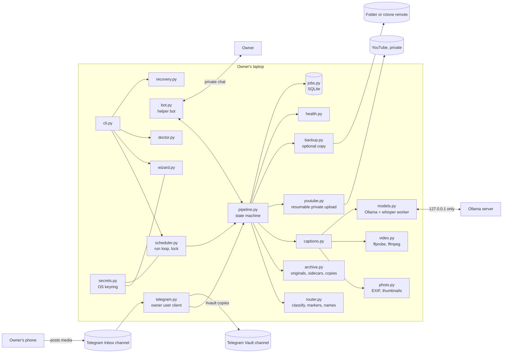
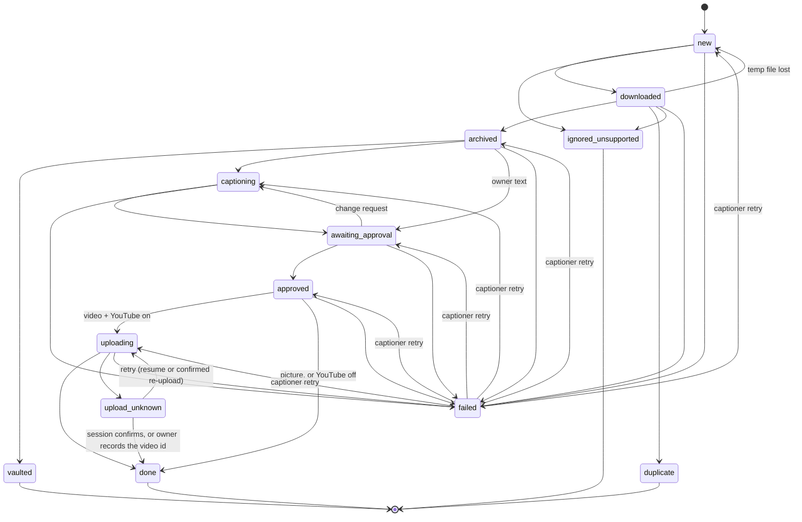
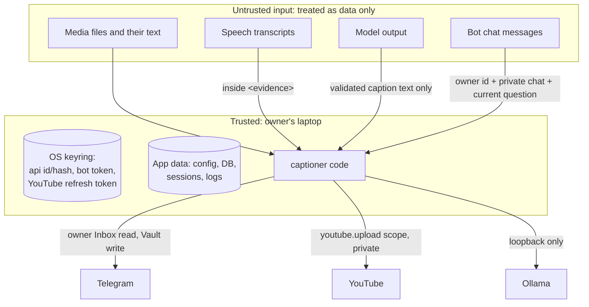
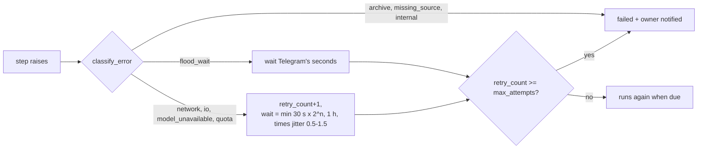

# Architecture

One Python process (`captioner run`) on the owner's laptop. Adapters talk to the outside world; `pipeline.py` moves each job through an explicit state machine stored in SQLite. Every name below is a real module or state in the code.

## Components



## Data flow for one item

```mermaid
sequenceDiagram
    participant I as Inbox
    participant P as pipeline
    participant A as archive
    participant M as local models
    participant B as bot (owner chat)
    participant Y as YouTube
    I->>P: scan from checkpoint / live NewMessage
    P->>P: register_message (idempotent, one transaction)
    P->>I: download original to tmp/job-N/download
    P->>A: sniff type, SHA-256, dedupe, copy + verify + atomic rename
    alt #vault or #private
        P->>I: send_to_vault (tagged "#pmc <hash>")
    else owner wrote text
        P->>P: caption = owner text, exactly
    else no text
        P->>M: frames/photo -> vision; audio -> whisper (context only); text model -> 2-3 lines
    end
    P->>B: one review per item or album
    B->>P: reply (owner only, to the current question)
    P->>A: approvals row, then JSON sidecar (+ metadata copy for pictures)
    P->>Y: videos only: insert with privacyStatus=private, resumable
    P->>B: link or error
```

## Job states

Transitions are checked centrally in `jobs.TRANSITIONS` and applied with compare-and-set (`UPDATE ... WHERE state = ?`).



`captioner retry` reopens a failed job at the step that failed (`recovery.RESUME_FROM`); a failure while archiving restarts from a fresh download.

## Tables

```mermaid
erDiagram
    albums ||--o{ inbox_messages : groups
    albums ||--o{ jobs : groups
    assets ||--o{ inbox_messages : "same file"
    inbox_messages ||--|| jobs : "one job per media message"
    assets ||--o{ jobs : archived_as
    jobs ||--o{ approvals : snapshot
    jobs ||--o{ uploads : attempts
    assets ||--o{ backup_jobs : copies
    albums { int id PK; int chat_id; int grouped_id; text last_item_at }
    assets { int id PK; text sha256 UK; text archive_path UK; text kind; int size; text archived_at }
    inbox_messages { int id PK; int chat_id; int message_id; int grouped_id; text text; int asset_id FK }
    jobs { int id PK; int inbox_message_id UK; text state; text caption; int rewrite_count; int retry_count; int question_id; int item_no }
    approvals { int id PK; int job_id FK; text caption; int owner_id; int question_id; text approved_at }
    uploads { int id PK; int job_id FK; int attempt; text state; text session_uri; int final_chunk_sent; text video_id; text privacy_status }
    backup_jobs { int id PK; int asset_id FK; text destination; text state; int checksum_ok; int retry_count }
    app_state { text key PK; text value }
```

`inbox_messages` is unique on `(chat_id, message_id)`; `assets` is unique on `sha256`. A repeated file arrives as a new message and job, which ends in `duplicate` linked to the existing asset.

## Security boundaries



## Retries and backoff



Upload quota errors wait 6 hours. Model unavailability falls back to "needs your caption" after the last attempt instead of failing. Backups retry separately in `backup_jobs` and never affect the job.

## Persistent artifacts

| Artifact | Written by | Atomic how |
|---|---|---|
| `archive/originals/YYYY/MM/<stem>__<hash12>.<ext>` | `archive.archive_original` | temp file in the same folder, fsync, hash check, `os.replace`, then read-only |
| `<original>.json` sidecar | `archive.write_sidecar` | temp file, fsync, `os.replace` |
| `archive/enriched/...` metadata copy | `archive.write_metadata_copy` | copy, ExifTool, read back, `os.replace`; original hash re-checked |
| `config.toml` | `config.save` | temp file, fsync, `os.replace` |
| `captioner.db` (WAL) | `jobs` | `BEGIN IMMEDIATE` transactions |
| `sessions/*.session` | Telethon | owner-only permissions where the OS supports them |
| `logs/captioner.log` | `secrets.setup_logging` | rotating, redacted |
